# CommonGround system design

Updated October 31, 2026. Implementation map for the hackathon demo. Source architecture is separate from verified deployment; the pitch ledger records evidence.

## Product boundary

An advocate listens privately, offers a shareable brief, and sends only the exact reviewed and explicitly authorized words to other advocates. People make their own current-version decisions. Fictional perspectives and scenario seeds never supply real owner consent.

```mermaid
flowchart LR
  Owner[Owner or demo visitor] --> Browser[Bilingual browser]
  Owner --> Phone[Paired phone call]
  Phone --> Private[Private participant state]
  Browser --> Private
  Private --> Review[Review exact brief]
  Review -->|Explicit authorization| Relay[Agent Relay advocates]
  Relay --> Proposal[Versioned proposal]
  Proposal --> Human[Human review and decision]
  Human --> State[Negotiation state]
  Official[Official published agendas] --> Index[Cited item and page extraction]
  Index --> Retrieval[Vector or labeled keyword retrieval]
  Retrieval --> Private
  Index --> Watch[Consented topic watch]
  Watch --> Inbox[Private alert inbox]
  Inbox -->|Separate browser permission| Push[Browser push]
  Inbox -->|Separate own-number call opt-in| Outbox[Durable agenda-call intent]
  Outbox -->|One attempt per alert and one per day| Twilio[Twilio outbound call]
  Twilio --> Notice[Generic notice in saved language]
  Notice -->|Fresh code for intended workspace| Phone
```

## Workspaces and durable state

The server resolves an opaque visitor session. Participant state keeps private drafts, language, phone pairing and watch preferences. Negotiation state keeps authorized briefs, versions, contributor decisions, receipts and public contribution history. Terse is selected explicitly; local SQLite is a separately labeled mode, not an invisible fallback.

Private is the default. Joining the shared neighborhood is explicit and begins as observation. Authorizing a reviewed brief enrolls the visitor as a contributor. Fictional business perspective and visitor identity are separate. Shared votes count actual contributors and are version-bound. Visitors cannot reset shared history.

Optimistic revision checks reject stale writes. New authorized context makes an old proposal stale. Unsent browser text survives refresh prompts. A reviewed send is stored as an intent before Relay dispatch; failed sends remain recoverable without falsely publishing the brief or repeating a successful send.

## Browser and phone interfaces

State actions remain revisioned: understand, share, negotiate, decision and revise. Cookie-scoped interfaces add workspace join/return, phone pairing, agenda search, watch consent, alert read state and optional push subscriptions. The browser never receives a Supabase service key.

The phone card displays only a server-provided number and expiring keypad pairing code. Pairing links the call to the selected perspective, language and workspace. Voice intake does not authorize cross-advocate sharing. The phone review reads the exact brief and requires an explicit confirmation key after playback; the browser also offers editable exact-brief review and explicit consent.

The added public features module mounts workspace, phone, proactive share and agenda controls around the existing guided interface. The service worker handles optional push and opens the same-origin Evidence view; it does not cache private API responses.

## Agenda evidence and alerts

The bounded corpus uses official SFMTA meeting pages and agenda/minutes PDFs. Extraction preserves meeting date, original URL, item and PDF page. Past discussion and published upcoming agendas are searchable. Scheduled meetings without published agendas remain awaiting publication; future agenda contents are never synthesized.

Supabase vector retrieval and cited local keyword retrieval carry distinct modes. Initial corpus/watch population produces baseline inbox matches without pretending old documents are new publications. Later relevant changes are deduplicated and can enqueue push only for visitors who separately enabled it. Server-managed delivery retries, expired subscriptions and read state keep status honest.

Opted-in agenda calls are a separate delivery channel, deployed at 3:09:50 p.m. Pacific. A recent code-paired inbound number plus explicit own-number consent is required. The worker persists a call intent before its single Twilio creation attempt; ambiguous outcomes are not automatically redialed. Automatic calls are capped at one per day. Explicit manual labeled tests are separately capped at three per hour, require a terminal prior test and fresh confirmation, and never retry active/unknown calls automatically. An answerer can stop future calls with keypad 9. No private history or agenda details are spoken before a fresh code binds the intended workspace. After pairing, the exact triggering alert supplies title, passage, meeting date, source URL, item and page to Live. The user-only test endpoint labels an existing source as TEST and uses the separate manual-test cap. An initial 171-second real test verified ringing/English pairing but failed source awareness. A later 106-second retest heard the correct specific TEST/source greeting but captured zero caller transcript. The long source announcement before microphone connection is removed in a local correction with aggregate audio diagnostics; 38 isolated checks pass, deployment/retest pending.

## Verification and timing

On October 31, 17 isolated workspace/agenda tests and public JavaScript syntax checks passed. The hosted private integration proof completed at 1:17 p.m. Pacific and verifies session isolation, six actual Relay receipts, a contributor decision, bilingual revision, approval reset, stale-version rejection and past/upcoming Supabase vector retrieval. The lead also verified genuine Terse runtime restart persistence and hosted source-card rendering. Actual inbound calls now verify code-first flow, exact brief consent and visible private/shared delivery; outbound ringing/pairing is also verified. A later 106-second outbound test heard the specific TEST/source greeting but captured zero caller transcript. Its local reply-path correction has 38 isolated passes and awaits deployment/retest. One-page browser QA and actual receipt/watch/inbox UI passed; browser push remains unverified.

The 3 p.m. ready target passed after late critical requests; the deadline remains 4 p.m. Pacific. Code is frozen except blocking bugs. The selected 142-word real-story pitch has generated 54.20-second WAV / 54.23-second MP3 audio; the prior 139-word audio is preserved at 53.95 seconds. The updated 117.766667-second cut has passed media decode/visual QA; hosted replacement verification and human pacing feedback are still separate gates. The user uploads manually as unlisted and supplies the link.

Latest operational status (October 31, 3:34 p.m. Pacific): Outbound carrier delivery and fresh English-code pairing were verified in a 171-second test. A later 106-second user retest heard the correct specific TEST/source greeting and question, but captured zero caller transcript: the reply path failed. A local correction removes the long source announcement before the microphone connects and adds aggregate audio diagnostics; 38 isolated checks pass. That correction is not yet deployed or carrier-retested, and the complete outbound conversation is not accepted as working. Browser preview audio played technically; that does not prove a telephone call or source understanding.
